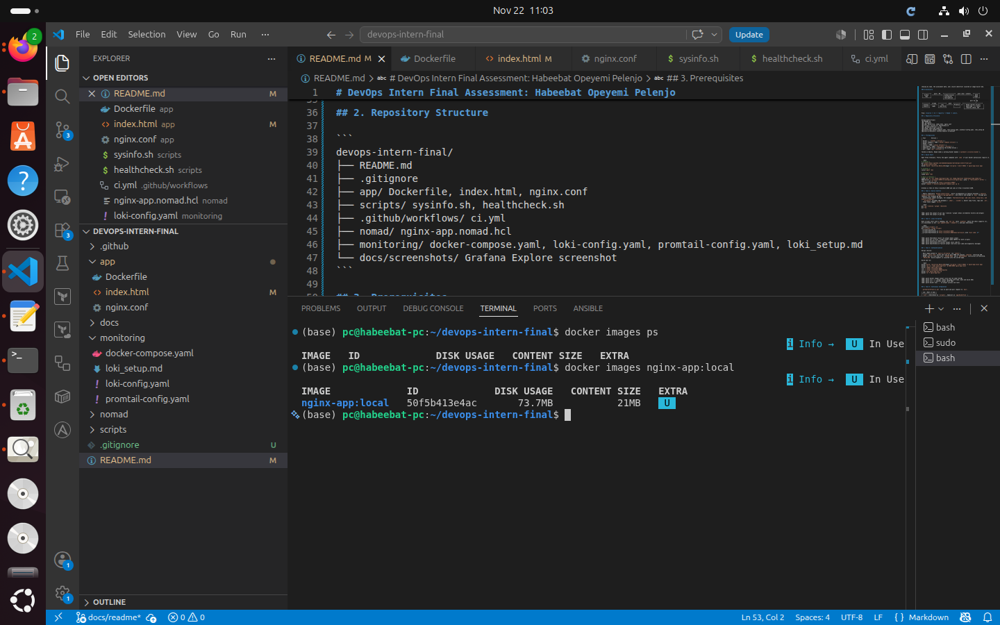
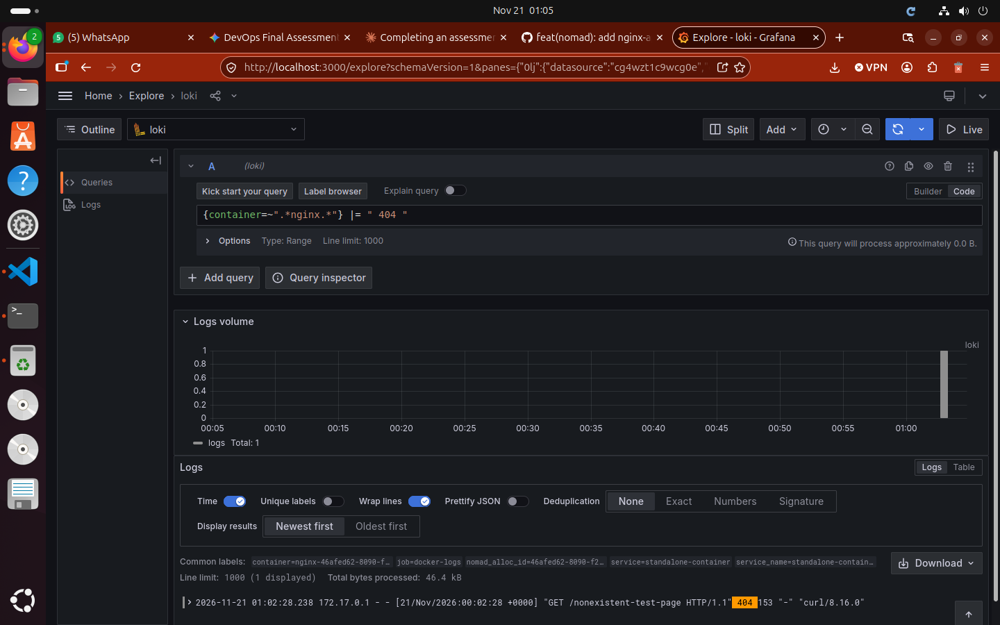

# DevOps Intern Final Assessment: Habeebat Opeyemi Pelenjo

[](https://github.com/habeebatopeyemi-dot/devops-intern-final/actions/workflows/ci.yml)

- **Author:** Habeebat Opeyemi Pelenjo
- **Submission date:** 2026-11-22
- **Repository:** https://github.com/habeebatopeyemi-dot/devops-intern-final
- **Release tag:** `v1.0.0`


##  Overview

An end-to-end pipeline for a containerised NGINX static site. Source code is built and checked by GitHub Actions, the image is published to GitHub Container Registry (GHCR), deployed to a HashiCorp Nomad cluster (with Consul for service registration and health checks), and its logs are shipped to Grafana Loki through Promtail and explored in Grafana.

The web app itself was written from scratch for this assessment. It is a single static page showing my name, the assessment date, and a build identifier injected at image build time.

###  Architecture

```
 +-----------+    push / PR    +----------------+   push (sha + latest)   +--------+
 |  GitHub   | --------------> | GitHub Actions | ----------------------> |  GHCR  |
 |   repo    |                 | lint/build/    |                         | image  |
 +-----------+                 | test/publish   |                         +---+----+
                               +----------------+                             |
                                                                      pull by tag
                                                                              v
 +---------+   scrape   +----------+   push   +--------+   +---------------------------+
 | Grafana | <--------- |   Loki   | <------- |Promtail| <-- |  Nomad (docker driver)    |
 | Explore |   LogQL    | log store|          |        |     |  nginx-app  <-> Consul    |
 +---------+            +----------+          +--------+     |  /healthz check, 10s      |
                                                             +---------------------------+
```

Flow: **source -> CI -> registry -> Nomad -> Loki**.

##  Repository Structure

```
devops-intern-final/
├── README.md
├── .gitignore
├── app/ Dockerfile, index.html, nginx.conf
├── scripts/ sysinfo.sh, healthcheck.sh
├── .github/workflows/ ci.yml
├── nomad/ nginx-app.nomad.hcl
├── monitoring/ docker-compose.yaml, loki-config.yaml, promtail-config.yaml, loki_setup.md
└── docs/screenshots/ Grafana Explore screenshot
```

##  Prerequisites

| Tool           |Version |
|----------------|--------|
| Docker         |v29.9.2 |
| Docker Compose | v5.6.1 |
| Nomad          | v2.1.1 | 
| Consul         |v2.1.0  |
| ShellCheck     | v0.9.0 |
| Git            | v2.43.0|

##  Start

* Nomad needs a working Docker daemon (`systemctl is-active docker`).

* Open three terminals. 

```bash
# Terminal 1
git clone https://github.com/habeebatopeyemi-dot/devops-intern-final.git
cd devops-intern-final

# Terminal 2
sudo consul agent -dev

# Terminal 3
sudo nomad agent -dev
```


##  Source Control

- Public repository `devops-intern-final`, built incrementally on feature branches (`feature/nomad-orchestration`, `feature/log-aggregation`, and others) and merged to `main` through pull requests.
- Conventional commit messages, for example `feat(monitoring): add Loki stack, setup docs, and Explore screenshot`.
- `.gitignore` excludes IDE metadata `.idea/`, editor swap files, logs and `.env`.
- Final state tagged `v1.0.0`.


##  Linux Scripting

Both scripts start with a shebang, use `set -eu` (plus `pipefail` where the shell supports it), are executable in Git (`git update-index --chmod=+x`), and pass ShellCheck.

In terminal 1, run:
```
shellcheck scripts/*.sh 
git ls-files --stage scripts/
./scripts/sysinfo.sh  
./scripts/healthcheck.sh http://localhost:8080
./scripts/healthcheck.sh http://localhost:8080/does-not-exist; echo "exit code: $?"
```

```
- shellcheck scripts/*.sh output: (no output)
- git ls-files --stage scripts/ output: (mode 100755 for both scripts)
- ./scripts/sysinfo.sh  output:
=== System Information Report ===
Current User: pc (UID: 1000)
Hostname: habeebat-pc
Kernel Release: 7.0.0-42-generic
System Date (ISO-8601): 2026-11-22T14:54:17Z
--- Disk Usage ---
Filesystem      Size  Used Avail Use% Mounted on
/dev/sda2       141G   56G   79G  42% /
--- Memory Usage ---
               total        used        free      shared  buff/cache   available
Mem:           7.7Gi       5.3Gi       197Mi        99Mi       2.3Gi       2.4Gi
Swap:          4.0Gi       2.8Gi       1.2Gi
--- Docker Daemon Status ---
Docker daemon is running.
- ./scripts/healthcheck.sh http://localhost:8080 output:
Checking health of target: http://localhost:8080
SUCCESS: Endpoint /healthz returned HTTP 200.
- ./scripts/healthcheck.sh http://localhost:8080/does-not-exist; echo "exit code: $?" output:
Checking health of target: http://localhost:8080/does-not-exist
FAILURE: Endpoint /healthz returned HTTP status: 404
exit code: 1
```


##  Containerisation

- Base image pinned to `nginx:1.27-alpine` (no `latest`).
- Custom `nginx.conf` serves the site on port 8080 and exposes `/healthz` returning 200.
- NGINX runs as a non-root user; `EXPOSE 8080` and a `HEALTHCHECK` instruction are declared.
- `BUILD_SHA` build argument is injected into the served page.

Build and run:

```bash
docker build --build-arg BUILD_SHA=$(git rev-parse --short HEAD) -t nginx-app:local app/
docker run -d --name nginx-app-test -p 8080:8080 nginx-app:local
docker images nginx-app:local
curl -i http://localhost:8080/
curl -i http://localhost:8080/healthz
docker exec nginx-app-test id
docker rm -f nginx-app-test
```

```
- docker images nginx-app:local 
 
- curl -i http://localhost:8080/ output: 
HTTP/1.1 200 OK 
Server: nginx/1.27.5
Date: Sun, 22 Nov 2026 19:55:31 GMT
Content-Type: text/html
Content-Length: 823
Last-Modified: Sun, 22 Nov 2026 10:36:45 GMT
Connection: keep-alive
ETag: "6b02c5bd-337"
Accept-Ranges: bytes
- curl -i http://localhost:8080/healthz output:
HTTP/1.1 200 OK
Server: nginx/1.27.5
Date: Sun, 22 Nov 2026 20:30:14 GMT
Content-Type: application/octet-stream
Content-Length: 2
Connection: keep-alive
Content-Type: text/plain
- docker exec nginx-app-test id output:
uid=101(nginx) gid=101(nginx) groups=101(nginx)
```


##  Continuous Integration

`.github/workflows/ci.yml` runs on push and pull request to `main`.

| Job    | What it does |
|-----------|--------------|
| `lint`    | ShellCheck on `scripts/`, hadolint on `app/Dockerfile` |
| `build`   | Builds the image with `BUILD_SHA=${{ github.sha }}` |
| `test`    | Starts the container, waits for readiness, runs `scripts/healthcheck.sh`; fails if `/healthz` is not 200 |
| `publish` | On push to `main` only: pushes to `ghcr.io` tagged with the commit SHA and `latest` |

Security: third-party actions are pinned to a major version, workflow permissions are least-privilege (`contents: read`, plus `packages: write` only in the publish job), and registry login uses the built-in `GITHUB_TOKEN`. No long-lived credentials are stored in the repository.

- Green pipeline on `main`: https://github.com/habeebatopeyemi-dot/devops-intern-final/tree/1cd23561ae465c4c34e95cefa1076827bbb09c8d/.github/workflows
- Published image: https://github.com/habeebatopeyemi-dot/devops-intern-final/pkgs/container/devops-intern-final


##  Orchestration with Nomad

`nomad/nginx-app.nomad.hcl` deploys the image built by CI.

- `type = "service"`, one group (`web`), one task (`nginx`) with the `docker` driver.
- Image `${var.image_repo}:${var.image_tag}`. The tag is an HCL variable, so every deployment uses an explicit tag (the commit SHA from CI).
- Resources: 100 MHz CPU and 64 MB memory.
- Dynamic port allocation: named port `http` mapped to container port 8080.
- Consul service registration (`nginx-app`) with an HTTP check on `/healthz` (interval 10s, timeout 2s).
- `update` stanza: `max_parallel = 1`, `min_healthy_time = "10s"`, `healthy_deadline = "2m"`, `auto_revert = true`.
- `restart` and `reschedule` policies configured.

Commands (the tag is the full commit SHA of the image published to GHCR by CI):

```bash
TAG=03f0017ba4d41aad207971f762e53011d2a8345d
nomad job validate -var image_tag=$TAG nomad/nginx-app.nomad.hcl
nomad job plan     -var image_tag=$TAG nomad/nginx-app.nomad.hcl
nomad job run      -var image_tag=$TAG nomad/nginx-app.nomad.hcl
nomad job status nginx-app
```

```
- nomad job validate output: Job validation successful
- nomad job plan output:
+/- Job: "nginx-app"
+/- Task Group: "web" (1 create/destroy update)
  +/- Task: "nginx" (forces create/destroy update)
    +/- Config {
      +/- image:    "ghcr.io/habeebatopeyemi-dot/devops-intern-final:03f0017ba4d41aad207971f762e53011d2a8345d" => "ghcr.io/habeebatopeyemi-dot/devops-intern-final:"
          ports[0]: "http"
        }

Scheduler dry-run:
- All tasks successfully allocated.
- nomad job run output:
 ✓ Deployment "3741ea04" successful
    
    2026-11-23T00:54:14+01:00
    ID          = 3741ea04
    Job ID      = nginx-app
    Job Version = 0
    Status      = successful
    Description = Deployment completed successfully
    
    Deployed
  Task Group  Auto Revert  Desired  Placed  Healthy   Unhealthy    Progress Deadline
  web           true           1          1         1          0         2026-11-23T01:10:05+01:00
- nomad job status output:
Summary
Task Group  Queued  Starting  Running  Failed  Complete  Lost  Unknown
web         0       0         1        0       0         0     0

Latest Deployment
ID          = 3741ea04
Status      = successful
Description = Deployment completed successfully

Deployed
Task Group  Auto Revert  Desired  Placed  Healthy  Unhealthy  Progress Deadline
web         true         1        1       1        0          2026-11-23T01:10:05+01:00

Allocations
ID        Node ID   Task Group  Version  Desired  Status   Created       Modified
2ec4ec3f  16c3226c  web         0        run      running  11s from now  5m41s ago
```


##  Log Aggregation with Grafana Loki

The stack (Loki 3.1.1, Promtail 3.1.1, Grafana 11.2.2, images pinned) is defined in `monitoring/docker-compose.yaml`, with `loki-config.yaml` and `promtail-config.yaml` committed rather than pulled as defaults. Promtail reads Docker container logs through the Docker socket and attaches the labels `job`, `container`, `service` and `nomad_alloc_id`.

```bash
docker compose -f monitoring/docker-compose.yaml up -d
curl -s http://localhost:3100/ready
curl -i http://localhost:<port>/this-page-does-not-exist     # generate a 404
```

LogQL query that isolates NGINX access log lines with a 404:

```
{container=~".*nginx.*"} |= " 404 "
```



Full details (how the stack was started, labels, queries, results, and problems with fixes) are in [monitoring/loki_setup.md](monitoring/loki_setup.md).

## 11. Troubleshooting

Failures I hit while building this:

**1. `nomad job` commands fail with `connection refused` on `127.0.0.1:4646`**
- Cause: the Nomad agent was not running (the terminal that hosted it had been closed).
- Fix: start `nomad agent -dev` in its own terminal and confirm with `nomad node status` (node `ready`). Keep the Consul and Nomad terminals open.

**2. `docker build` fails with `401 Unauthorized: personal access token is expired`**
- Cause: an expired Docker Hub token saved in the local Docker credentials was sent even for public base images.
- Fix: `docker logout`, then rebuild (public images pull anonymously). 

**3. Nomad allocation fails and `nomad alloc logs` returns `404 (task "nginx" not started yet)`**
- Symptom: the deployment was marked unhealthy, allocations kept failing and there were no logs to read because the container never started.
- Diagnosis: `nomad alloc status <alloc-id>`, then **Recent Events**, showed `Failed to pull 'nginx-app:local': pull access denied ... repository does not exist or may require 'docker login'`.
- Cause: the job pointed at an image name that only exists on my machine (an earlier version used `nginx-app:latest`, which the Docker driver always pulls). Nomad tried to pull it from Docker Hub, where it does not exist, so the task never started.
- Fix: publish the image from CI to GitHub Container Registry (package set to public) and deploy it by its commit SHA tag, using the `image_tag` variable:

  ```bash
  nomad job stop -purge nginx-app
  nomad job run -var image_tag=$TAG nomad/nginx-app.nomad.hcl
  TAG=03f0017ba4d41aad207971f762e53011d2a8345d
  ```

  The job's `image_repo` default is `ghcr.io/habeebatopeyemi-dot/devops-intern-final`. The allocation then pulled the image, reported `Deployment Health = healthy` and ran with 0 restarts.
